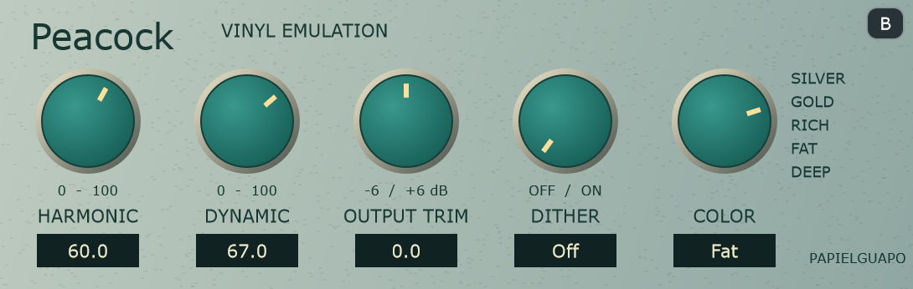

# Peacock

**Peacock** es un efecto VST3 de **PAPIELGUAPO** para Windows x64. Añade color inspirado en la reproducción de vinilo mediante saturación de medios y compresión de agudos. Funciona en pistas mono y estéreo. El DSP y la interfaz son propios: no es una conversión del AAX ni se ha verificado una equivalencia sonora 1:1.

**Cara A / Cara B.** Pulsa **B** en la esquina superior derecha para abrir el panel alternativo, o haz doble clic en la cabecera. La cara A sigue la distribución compacta de cinco mandos de la referencia; la B mantiene el mismo tamaño y los mismos mandos, añade siete paletas y muestra Color y Output Trim en el visor inferior. Las pestañas **CS, FL, PT, AB, LP, 98 y AT** solo cambian los colores. Pulsa **A** para volver. La cara y la paleta se guardan con la instancia, sin cambiar los parámetros de audio.

## Instalación

1. Descarga [Peacock para Windows x64](https://github.com/papielguapo/Peacock/releases/latest/download/Peacock-Windows-x64.zip) y descomprime el ZIP.
2. Copia **la carpeta completa** `Peacock.vst3` en `C:\Program Files\Common Files\VST3`.
3. Vuelve a escanear los plugins en tu DAW e inserta **Peacock** como efecto de audio.

## Controles

| Control | Qué cambia |
| --- | --- |
| **Harmonic** · 0–100 | Satura la banda media y atenúa los agudos en función de su nivel. Sube este control para suavizar un ataque brillante. |
| **Dynamic** · 0–100 | Añade una componente de segundo armónico y modifica su fase según la energía de los agudos. No es un control de volumen ni un compresor de banda completa. |
| **Output Trim** · ±6 dB | Ajusta el nivel después de la coloración y antes del dither. El valor neutro es 0 dB. |
| **Dither** · Off / On | En On añade ruido triangular coloreado y redondea a pasos de 1/32768; el bus sigue siendo flotante. Off no añade ruido ni redondeo. Por compatibilidad, valores intermedios de automatización de v0.1 conservan la mezcla continua de ruido sin redondeo. |
| **Color** | Silver, Gold, Rich, Fat y Deep cambian la banda y la intensidad de la coloración. Hacia Deep, el efecto alcanza frecuencias más graves. |

**Para escucharlo:** empieza con Harmonic, Dynamic y Dither en cero: la señal pasa sin cambios. En un bucle de batería, selecciona **Fat**, sube **Harmonic** a **60** y después **Dynamic** a **67**, como en la captura. Alterna el bypass del DAW para comparar el ataque de platos y caja. Deja Dither en cero si solo quieres escuchar la coloración.

## Comparación con el AAX

Desde un proyecto compilado, `python tools/compare.py` (requiere NumPy y Pedalboard) crea `build/comparison/input.wav` con un tono de 997 Hz a tres niveles y la respuesta del VST3. Importa la entrada en una sesión estéreo de Pro Tools a 48 kHz. Inserta solo el AAX, ajusta Harmonic 60, Dynamic 67, Fat, Trim 0 dB y Dither Off. Exporta exactamente los tres segundos, alineados, sin normalización, fades ni dither de exportación. Ejecuta `python tools/compare.py ruta/al/render.wav` para medir el residuo RMS y pico entre ambos. Un solo tono no valida la respuesta a transitorios ni a otras frecuencias o ajustes.
