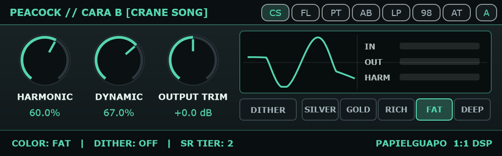

# Peacock (1:1 Hardware & DSP Study Edition)

**Peacock** es la recreación 1:1 en formato **VST3 (Windows x64)** de la emulación de corte y reproducción de vinilo **Crane Song Peacock**, desarrollada y documentada por **PAPIELGUAPO** para ejecución en DAW y estudio de ingeniería inversa DSP.

---

## Interfaz Dual: Cara A (1:1 Original) y Cara B (Phoenix II Deck)

### Cara A — Recreación 1:1 con Recursos Originales (`515 × 161 px`)

La **Cara A** utiliza los **12 recursos PNG originales** extraídos de la sección `.rsrc` del binario `Peacock.aaxplugin` y las coordenadas exactas `CRect` de VSTGUI (`0x18040CB20..0x18040D500`):

- Fondo hardware `res_PNG_31011_515x161.png` (`515 × 161 px`).
- Mandos continuos **Harmonic**, **Dynamic** y **Output Trim** con tira de **135 fotogramas** (`res_PNG_31010_60x8100.png`, `60 × 60 px` por frame) en `x = 19, 109, 199`, `y = 41`.
- Selector **Dither** (`Off` / `On`) de **2 fotogramas** (`res_PNG_31013_60x120.png`) en `x = 289, y = 41`, con zonas clicables directas sobre las etiquetas `Off` y `On`.
- Selector **Color** (`Silver`, `Gold`, `Rich`, `Fat`, `Deep`) de **5 fotogramas** (`res_PNG_31015_60x300.png`) en `x = 379, y = 41`, con zonas clicables directas sobre cada etiqueta.

### Cara B — Deck Adaptado Estilo Phoenix II (`515 × 161 px`, 7 Skins)

Pulsa el botón **B** en la cabecera (o haz doble clic en la barra superior) para alternar a la **Cara B**, inspirada en el método de **Crane Song Phoenix II**:

- Mantiene las dimensiones exactas (`515 × 161 px`), los mismos 5 parámetros automatizables y el motor DSP 1:1 sin cortes de audio.
- Incluye **7 paletas clásicas**: **CS** (Crane Song), **FL** (FL Studio), **PT** (Pro Tools), **AB** (Ableton), **LP** (Logic Pro), **98** (Win98 Retro) y **AT** (Atari ST).
- Visor en tiempo real de la curva de transferencia no lineal + modulación de fase y medidores **IN / OUT / HARM**.

---

## Estudio del Motor DSP 1:1 (`Source/PeacockDSP.h` y `Source/PeacockDSPData.h`)

El algoritmo completo del binario `Peacock.aaxplugin` (`Peacock_AlgorithmProcessFunction` en `0x180017870`, `Peacock_LookupWavetable` en `0x180019A70`, `GenerateCoefficients` en `0x180027450` y `Peacock_InitializeState` en `0x180028C00..0x180028FD0`) ha sido decompilado y traducido 1:1 a C++ documentado en:

- `Source/PeacockDSPData.h`: Los **16.386 floats IEEE-754 exactos** de `Peacock_Table_Data` (`0x180420DA0`).
- `Source/PeacockDSP.h`: Implementación completa bit-a-bit de las estructuras `SPeacock_Context`, `SPeacock_State` (`0xB80` bytes por canal) y todas las etapas del bucle por muestra.

### 1. Tabla de Búsqueda No Lineal (`Peacock_Table_Data`)

En lugar de usar un `tanh()` genérico, Peacock emplea una tabla de transferencia medida en hardware (`Peacock_Table_Data`, 16.386 floats):

- El índice `8192` es el punto cero (`-3.178651e-07f`).
- Hacia `0` tiende a `-0.99660665f` (saturación negativa asimétrica) y hacia `16385` tiende a `+0.99660575f`.
- `Peacock_LookupWavetable(x)` (`0x180019A70`) escala la señal por `8192.0f`, desplaza por `+8192.0f`, recorta a `[-0.9989, +0.9989]` e interpola linealmente entre muestras adyacentes.

### 2. Generación de Coeficientes (`GenerateCoefficients` @ `0x180027450`)

Los 5 controles de usuario se transforman al contexto DSP (`SPeacock_Context`) mediante:

- **Harmonic** (`0..100 %` $\rightarrow$ `0.0..1.0`): controla directamente la mezcla de la rama de saturación armónica (`ctx.harmonic`).
- **Dynamic** (`0..100 %` $\rightarrow$ `0.0..1.0`): controla la ganancia de compresión HF dependiente de envolvente y la profundidad de modulación de retardo/fase (`ctx.dynamic`).
- **Output Trim** (`-6..+6 dB`): se convierte en ganancia lineal mediante:
  $$\text{trimGain} = 10^{\text{dB} / 20}$$
  escalando el nivel de entrada al modelo físico.
- **Dither** (`Off` / `On`): activa una fuente TPDF de alta frecuencia ($\pm 7.6293945 \times 10^{-5}$, equivalente a $2^{-13}$) que se suma tanto a la entrada del seguidor dinámico como a la salida final.
- **Color** (`Silver = 0`, `Gold = 1`, `Rich = 2`, `Fat = 3`, `Deep = 4`): selecciona uno de los 5 perfiles de timbre mecánico/magnético del cabezal y aguja:

| Modo Color | `colorCoeffA` (`ctx+0x28`) | `colorCoeffB` (`ctx+0x2C`) | `colorGainA` (`ctx+0x30`) | `colorGainB` (`ctx+0x34`) |
| :--- | :---: | :---: | :---: | :---: |
| **0 · Silver** | `0.10` | `0.00` | `0.95` | `1.000` |
| **1 · Gold** | `0.25` | `0.00` | `0.90` | `1.000` |
| **2 · Rich** | `0.15` | `0.10` | `0.90` | `1.050` |
| **3 · Fat** | `0.30` | `0.15` | `0.85` | `1.060` |
| **4 · Deep** | `0.40` | `0.30` | `0.83` | `1.085` |

### 3. Inicialización por Frecuencia de Muestreo (`0x180028C00..0x180028FD0`)

El estado por canal (`SPeacock_State`) clasifica la frecuencia de muestreo en 4 escalas (`sampleRateTier`):

- **Tier 1** ($\le 52\text{ kHz}$: $44.1 / 48\text{ kHz}$): ventana de media móvil `tapSpan = 22`, constante de integración `envAlpha = 0.0005f`.
- **Tier 2** ($52..102\text{ kHz}$: $88.2 / 96\text{ kHz}$): `tapSpan = 44`, `envAlpha = 0.00025f`.
- **Tier 3** ($102..204\text{ kHz}$: $176.4 / 192\text{ kHz}$): `tapSpan = 88`, `envAlpha = 0.000125f`.
- **Tier 4** ($> 204\text{ kHz}$: $352.8 / 384\text{ kHz}$): `tapSpan = 176`, `envAlpha = 0.0000625f`.

### 4. Flujo de Señal por Muestra (`Peacock_AlgorithmProcessFunction` @ `0x180017870`)

Para cada muestra $x[n]$:

1. **Ganancia de entrada y detector dinámico:**
   - $x_{\text{trim}} = x[n] \cdot \text{trimGain}$.
   - Se extrae la componente de alta frecuencia mediante diferencia de primer orden ($x_{\text{trim}} - z_1$) + ruido TPDF, rectificada en valor absoluto ($|v|$) y suavizada con un integrador exponencial (`envAlpha`) seguido de una línea de retardo circular de 50 muestras (`dlyC`) para obtener `envFollow`.
   - La envolvente se limita suavemente pasando por `Peacock_LookupWavetable(envFollow * dynamic * 2.0f)`.
2. **Compresión de transitorios de alta frecuencia (rama Dynamic):**
   - La diferencia de agudos de la señal retardada 3 muestras se pondera por la envolvente saturada (`hfDynamicComp`), imitando la limitación física de velocidad de curvatura (*high-frequency tracing loss* / *slew limiting*) de la aguja sobre el surco.
3. **Generación de 2º armónico asimétrico y curva de saturación (rama Harmonic):**
   - Un filtro paso alto en cascada extrae la envolvente media, genera asimetría cuadrática ($u^2$) y alimenta dos llamadas a `Peacock_LookupWavetable`:
     - Una curva principal escalada por `0.2508f` (con ganancia `3.99f` de recuperación).
     - Una segunda curva en serie sobre la señal pre-comprimida.
4. **Filtro de resonancia y timbre según Color:**
   - Los coeficientes `colorCoeffA` y `colorCoeffB` aplican acoplamiento cruzado entre estados recursivos (`harmState6`, `harmState7`, `colorFilterState`), mientras `colorGainA` y `colorGainB` compensan el balance entre señal directa y armónicos.
5. **Línea de retardo de 512 muestras con interpolación polinómica de 4 puntos (Lagrange cúbico):**
   - La energía dinámica modula continuamente la posición fraccionaria de lectura (`modSmoothed * 20.0f` muestras) sobre el buffer circular `mainDelayLine[512]`, produciendo la micro-modulación de fase y *wow/tracing shift* característica del vinilo.

---

## Instalación

1. Descarga [Peacock para Windows x64](https://github.com/papielguapo/Peacock/releases/latest/download/Peacock-Windows-x64.zip) y descomprime el archivo ZIP.
2. Copia el bundle `Peacock.vst3` en `C:\Program Files\Common Files\VST3`.
3. Escanea tus plugins en tu DAW e inserta **Peacock** (fabricante **PAPIELGUAPO**).

